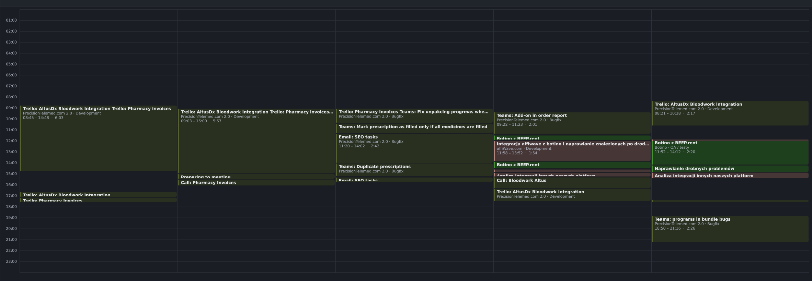

# 0090 — Każdy wpis w kalendarzu z czytelnym tytułem

> [!info] Status
> **do-zrobienia** · priorytet **p2** · [← tablica zadań](../../README.md)

## Cel

W kalendarzu da się przeczytać co najmniej tytuł każdego wpisu, bez stawiania krótkich wpisów obok następnych.

## Kontekst

- Prośba użytkownika (2026-11-20 13:08, zrzut niżej): krótkie wpisy mają ucięte tytuły — „minimalna wysokość, żeby można
  było
  przynajmniej tytuł przeczytać”.
- Wybór użytkownika: blok ma co najmniej wiersz tytułu, a tytuł następnego wpisu schodzi pod krótki; do tego
  oddalanie siatki tylko do skali, przy której każdy wpis ma wiersz.
- Historia: [0078](../../ZROBIONE/0078-sekundy-w-kalendarzu-i-klik-na-gnome/todo.md) — minimalna wysokość w układzie
  kolumn stawiała krótki wpis obok następnego (odrzucone, 0.10.13: blok tak wysoki, jak trwa);
  [0079](../../ZROBIONE/0079-skala-kalendarza/todo.md) — skala 32–384 px na godzinę;
  [0089](../../ZROBIONE/0089-kolko-przewija-kalendarz/todo.md) — Alt + kółko przybliża.
- Opis: [F-37 Kalendarz](../../../docs/architektura/funkcje.md#f-37-kalendarz-0105).

## Kryteria akceptacji

- [ ] Blok ma co najmniej 20 px (wiersz tytułu); krótki rysowany nad następnym, a tytuł następnego zaczyna się pod
  nim (także w łańcuchu kilku krótkich).
- [ ] Najmniejsza skala zależy od pokazanych wpisów: każdy wpis, który przy 384 px na godzinę zmieści wiersz
  (od ok. 3 min), ma co najmniej 20 px; krótsze nie blokują oddalania.
- [ ] Zapamiętana skala to wybór użytkownika, nie wymuszona granica.
- [ ] Testy, dokumentacja, zrzut po zmianie, wydanie.

## Kroki

- [ ] Rdzeń: granica skali i przesunięcie tytułów (`core/calendar.py`) z testami.
- [ ] `CalendarPage`: skala widoczna = max(wybrana, granica); przeliczenie przy zmianie skali.
- [ ] QML: minimalna wysokość bloku i przesunięty tytuł.
- [ ] Dokumentacja, zrzut, wydanie.

## Materiały

Przed zmianą — ucięte tytuły krótkich wpisów przy małej skali:

## Dziennik

### 2026-11-20 13:08

- Utworzono zadanie.

## Wynik

<!-- Wypełniane przy zamknięciu: co powstało, gdzie, co zostało na później. -->
