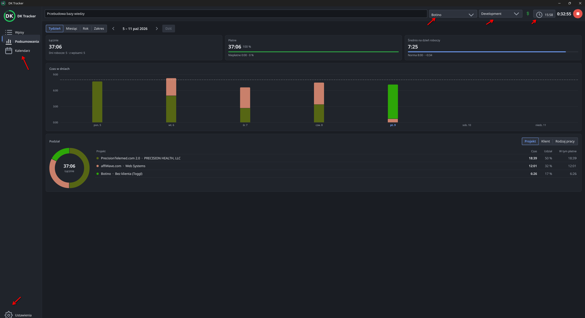

# 0080 — Ikony okna przesunięte i za duże przy ekranach o różnej skali

> [!info] Status
> **w-trakcie** · priorytet **p1** · [← tablica zadań](../../README.md)

## Cel

Ikony okna głównego (pasek boczny, strzałki list, zegar, znak DK) mają swój rozmiar i są wyśrodkowane
na każdym ekranie, także gdy w sesji jest ekran o innej skali.

## Kontekst

- Zgłoszenie użytkownika w 0.10.16: ikony „po przesuwane” — za duże, zjechane w dół i w prawo, zębatka
  ustawień wystaje poza przycisk.
- Sesja KDE Wayland ma wirtualny ekran „Telefon” ze skalą 2, a okno stoi na DP-6 ze skalą 1.
  `QGuiApplication.devicePixelRatio()` to wtedy 2.
- Dostawca `image://glyph` / `image://icons` w
  [window.py](../../../src/dk_tracker/ui/main_window/window.py) zwracał `QIcon.pixmap()` (skala aplikacji,
  czyli 2×), a `mark()` w [icons.py](../../../src/dk_tracker/ui/icons.py) rysuje zawsze 2×. Qt Quick bierze
  rozmiar pixmapy od dostawcy dosłownie, więc ikona wychodziła większa niż `sourceSize`. Do tego minimum 16 px
  powiększało kłódkę 12 px.
- Powiązane: [wygląd okna głównego](../../../docs/architektura/wyglad-okna-glownego.md).

## Kryteria akceptacji

- [x] Dostawca zwraca pixmapę dokładnie w żądanym rozmiarze (bez skali aplikacji, bez minimum 16 px).
- [x] Obrazy ikon w QML mają jawny rozmiar, więc nie rosną nawet przy większej pixmapie.
- [x] Test: dostawca zwraca żądany rozmiar.
- [ ] Wydanie z poprawką, sprawdzone u użytkownika.

## Kroki

- [x] Dostawca ikon: rysowanie w żądanym rozmiarze.
- [x] QML: jawne `width`/`height` ikon.
- [ ] Test, zrzuty, wydanie.

## Materiały

## Dziennik

### 2026-10-09 16:33

- Utworzono zadanie. Przyczyna ustalona przez `kscreen-doctor -o`: ekran „Telefon” ze skalą 2.
- **16:34** Start: poprawka dostawcy ikon.

### 2026-10-09 16:50

- Dostawca rysuje dokładnie żądany rozmiar (`glyph_pixmap`, `mark(..., scale=1)`), obrazy w QML mają jawny
  rozmiar, test `test_icon_provider_returns_exactly_the_requested_size`. Przy okazji: znak DK w pasku bocznym był
  2× za duży przy każdej skali. Zrzuty w dokumentacji odświeżone, wersja 0.10.17 zacommitowana.
- Paczka zbudowana; instalacja lokalna odrzucona (zdalne `dk-tracker` wymaga GPG). Czeka na wypchnięcie
  i `flatpak update` u użytkownika.

## Wynik

<!-- Wypełniane przy zamknięciu: co powstało, gdzie, co zostało na później. -->
