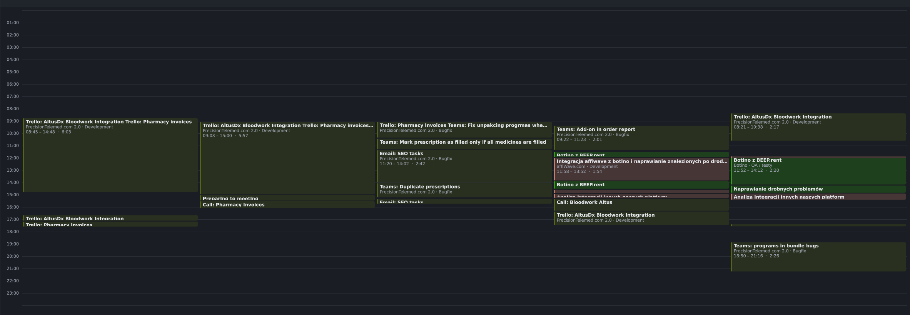
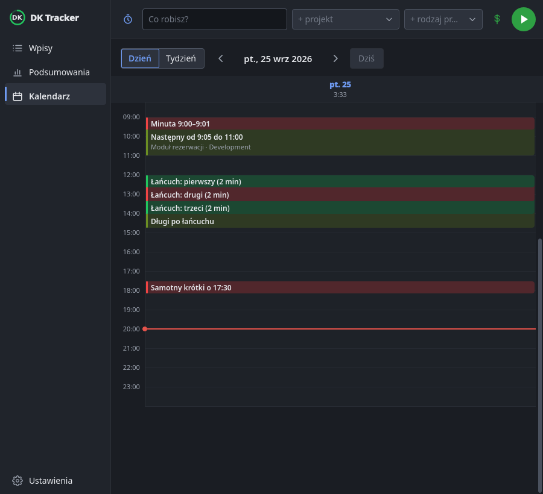
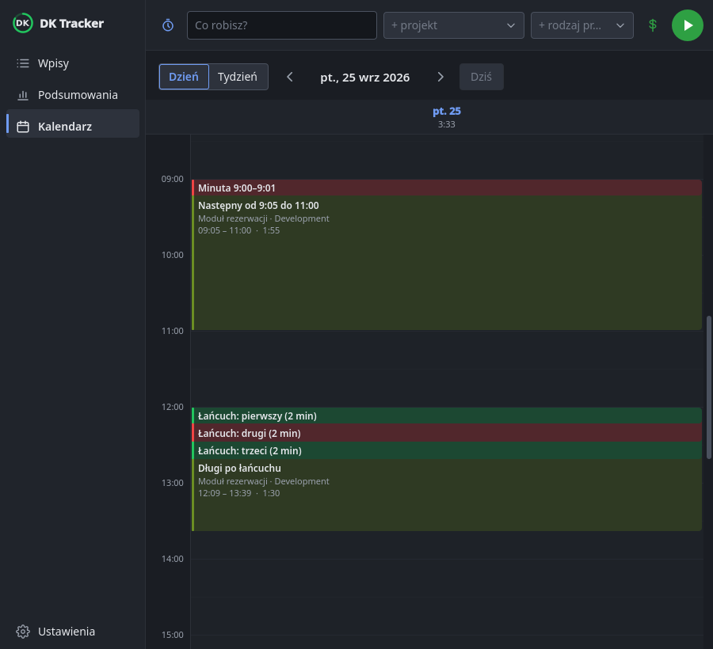
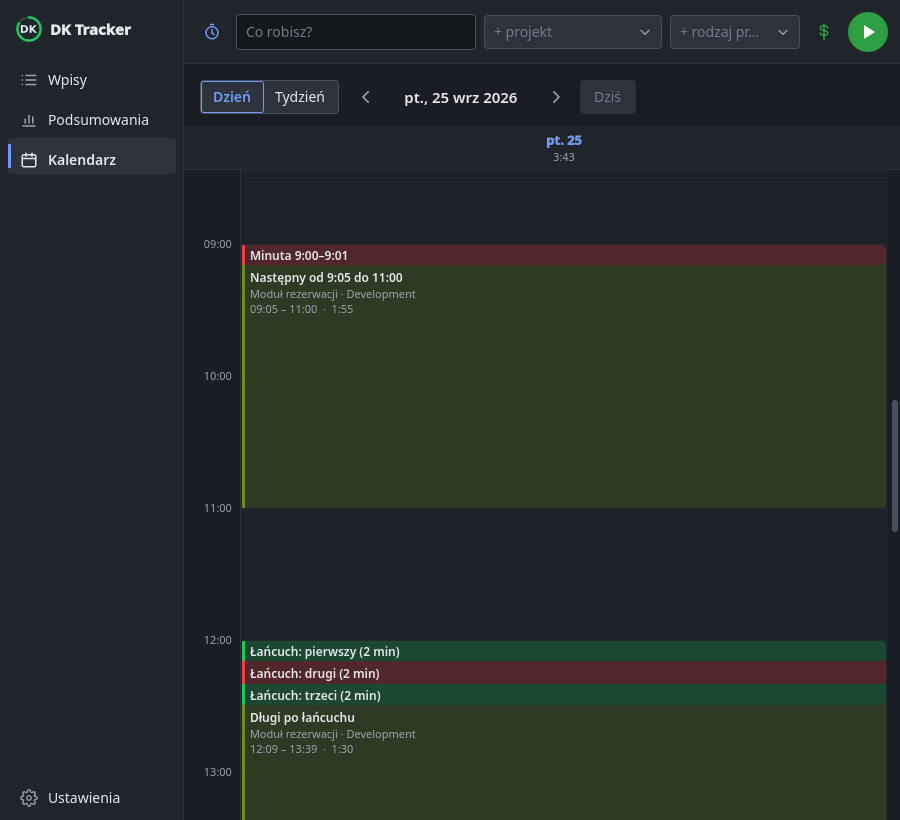

# 0090 — Każdy wpis w kalendarzu z czytelnym tytułem

> [!info] Status
> **zrobione** · priorytet **p2** · [← tablica zadań](../../README.md)

## Cel

W kalendarzu da się przeczytać co najmniej tytuł każdego wpisu, bez stawiania krótkich wpisów obok następnych.

## Kontekst

- Prośba użytkownika (2026-11-20 13:08, zrzut niżej): krótkie wpisy mają ucięte tytuły — „minimalna wysokość, żeby można
  było
  przynajmniej tytuł przeczytać”.
- Wybór użytkownika: blok ma co najmniej wiersz tytułu, a tytuł następnego wpisu schodzi pod krótki; do tego
  oddalanie siatki tylko do skali, przy której każdy wpis ma wiersz.
- Historia: [0078](../0078-sekundy-w-kalendarzu-i-klik-na-gnome/todo.md) — minimalna wysokość w układzie
  kolumn stawiała krótki wpis obok następnego (odrzucone, 0.10.13: blok tak wysoki, jak trwa);
  [0079](../0079-skala-kalendarza/todo.md) — skala 32–384 px na godzinę;
  [0089](../0089-kolko-przewija-kalendarz/todo.md) — Alt + kółko przybliża.
- Opis: [F-37 Kalendarz](../../../docs/architektura/funkcje.md#f-37-kalendarz-0105).

## Kryteria akceptacji

- [x] Blok ma co najmniej 22 px (wiersz tytułu); krótki rysowany nad następnym, a tytuł następnego zaczyna się pod
  nim (także w łańcuchu kilku krótkich).
- [x] Najmniejsza skala zależy od pokazanych wpisów: każdy wpis, który przy 384 px na godzinę zmieści wiersz
  (od ok. 3 min), ma co najmniej 20 px; krótsze nie blokują oddalania.
- [x] Zapamiętana skala to wybór użytkownika, nie wymuszona granica.
- [x] Testy, dokumentacja, zrzut po zmianie, wydanie.

## Kroki

- [x] Rdzeń: granica skali i przesunięcie tytułów (`core/calendar.py`) z testami.
- [x] `CalendarPage`: skala widoczna = max(wybrana, granica); przeliczenie przy zmianie skali.
- [x] QML: minimalna wysokość bloku i przesunięty tytuł.
- [x] Dokumentacja, zrzut, wydanie.

## Materiały

Przed zmianą — ucięte tytuły krótkich wpisów przy małej skali:

Po zmianie (render offscreen, [skrypt](testy/zrzut-wierszy.py)): 9:00–9:01 i 9:05–11:00, łańcuch trzech
dwuminutowych, samotny krótki o 17:30. Najdalsza skala (32 px na godzinę), tytuły czytelne:

Te same wpisy przy 96 px na godzinę:

Z wpisem 10-minutowym oddalanie zatrzymuje się na 132 px na godzinę:

## Dziennik

### 2026-11-20 13:08

- Utworzono zadanie.
- **13:09** Start pracy.
- **13:13** Kod (fde2533), dokumentacja (a009820), zrzuty po zmianie, wersja 0.10.23; pytest 873 zielonych.

## Wynik

- Rdzeń: `TITLE_HEIGHT` (22 px), `zoom_floor` i `titled` w
  [core/calendar.py](../../../src/dk_tracker/core/calendar.py); skala pokazana = max(wybrana, granica) w
  [calendar_page.py](../../../src/dk_tracker/ui/main_window/calendar_page.py); blok w
  [CalendarBlock.qml](../../../src/dk_tracker/ui/main_window/qml/CalendarBlock.qml) (`fde2533`).
- Opis: [F-37](../../../docs/architektura/funkcje.md#f-37-kalendarz-0105) (`a009820`). Wydanie 0.10.23.
- Wiersz 20 px z pierwszej wersji ucinał dolne laski liter — stąd 22 px.
