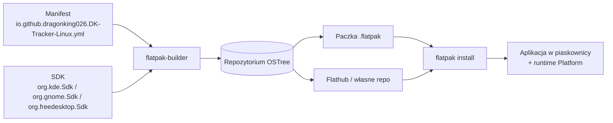

# Flatpak — format dystrybucji

> [!info] W skrócie
> Aplikacja jest budowana i instalowana jako Flatpak: działa w piaskownicy, na wspólnym
> runtime, identycznie na Fedorze KDE, Fedorze GNOME, Ubuntu itd.

## Pojęcia



- **Runtime** — wspólna baza bibliotek (`*.Platform`), **SDK** — to samo + narzędzia
  budowania (`*.Sdk`).
- **Manifest** (YAML/JSON) — ID aplikacji, runtime, uprawnienia (`finish-args`),
  moduły do zbudowania ze źródłami.
- **ID aplikacji** — odwrócona domena. Propozycja: `io.github.dragonking026.DK-Tracker-Linux`
  (do potwierdzenia w ADR — ID trudno zmienić po publikacji).

## Runtime'y (Flathub, stan 2026-09-25)

| Runtime | Dla kogo | Aktualne gałęzie |
| --- | --- | --- |
| `org.kde.Platform` | Qt / KDE Frameworks | `6.10`, `6.11` |
| `org.gnome.Platform` | GTK / libadwaita | `49`, `50`, `51` |
| `org.freedesktop.Platform` | wszystko inne (np. Tauri, Electron z BaseApp) | `24.08`, `25.08`, `26.08` |

Wybór runtime wynika ze stosu (ADR). Źródło opisów:
[Available Runtimes](https://docs.flatpak.org/en/latest/available-runtimes.html).

## Qt w paczce (ADR-0008)

Od 0.10.20 paczka stoi na **`org.freedesktop.Platform` 26.08** (bez Qt) i niesie własne Qt
([ADR-0008](../decyzje/0008-qt-w-paczce-flatpak.md)); wcześniej `org.kde.Platform` 6.11 z bazą
`io.qt.PySide.BaseApp`. Moduły manifestu:

| Moduł | Skąd | Po co |
| --- | --- | --- |
| `python3-deps` | koła PyPI ([python3-deps.yaml](../../flatpak/python3-deps.yaml)) | httpx, jeepney |
| `krb5` | [MIT Kerberos](https://kerberos.org/dist/) 1.22.2, ze źródeł | `libgssapi_krb5.so.2` — wymaga go QtNetwork, a runtime freedesktop go nie ma |
| `pyside6` | koła `shiboken6` i `pyside6-essentials` z PyPI | PySide6 **z Qt w środku** (biblioteki, QML, wtyczki Wayland/XCB, ICU); narzędzia deweloperskie i zbędne wtyczki usuwa `build-commands` |
| `qt-sdk` | [oficjalne binaria Qt](https://download.qt.io/online/qtsdkrepository/linux_x64/desktop/) tej samej wersji (qtbase, qtdeclarative, qtwayland w 7z) | tylko na czas budowy: nagłówki i CMake dla `layer-shell-qt`; usuwa je `cleanup` |
| `extra-cmake-modules` | [KDE Frameworks](https://download.kde.org/stable/frameworks/) 6.31 | tylko na czas budowy `layer-shell-qt` |
| `layer-shell-qt` | KDE Plasma 6.7.5 | okno przy tacce na KDE ([layer-shell-qt](layer-shell-qt.md)); `RUNPATH` wskazuje Qt z koła, wtyczka trafia do `PySide6/Qt/plugins/wayland-shell-integration` |
| `dk-tracker` | to repozytorium | aplikacja |

Wersję PySide6 i binariów Qt podnosi razem strażnik ([GitHub Actions](github-actions.md),
[straznik.py](../../flatpak/straznik.py)); zgodność obu wersji i zakresu z `pyproject.toml` sprawdza
[test_pakiet.py](../../tests/test_pakiet.py). Czy zainstalowana paczka startuje, sprawdza samotest:

```bash
flatpak run --command=python3 io.github.dragonking026.DK-Tracker-Linux -m dk_tracker.ui.selfcheck
```

## Planowane uprawnienia (`finish-args`)

```yaml
finish-args:
  - --share=ipc
  - --socket=wayland
  - --socket=fallback-x11                    # zgodność: Wayland + X11
  - --device=dri                             # akceleracja grafiki (jeśli UI jej używa)
  - --share=network                          # połączenie z Kimai
  - --talk-name=org.kde.StatusNotifierWatcher  # ikona w tacce (SNI)
  - --talk-name=org.freedesktop.secrets     # token w KWallet / GNOME Keyring (ADR-0004)
```

Zasady z [Sandbox Permissions](https://docs.flatpak.org/en/latest/sandbox-permissions.html):
minimalny zestaw `--talk-name`, nigdy `--socket=session-bus`, portale zamiast
bezpośredniego dostępu. `--share=network` tylko gdy aplikacja naprawdę potrzebuje sieci
(u nas — tak).

Sekrety: [ADR-0004](../decyzje/0004-architektura-rdzen-python-ui-qt.md),
[jeepney](jeepney.md). Autostart i powiadomienia idą przez portale i **nie** wymagają `finish-args`
([Portale XDG](xdg-portale.md)).

## Budowanie lokalnie

Zawsze w kontenerze ([ADR-0006](../decyzje/0006-budowanie-flatpaka-w-kontenerze.md)), tym samym obrazem co w CI:

```bash
flatpak/buduj.sh              # dist/io.github.dragonking026.DK-Tracker-Linux-<wersja>.flatpak: walidacja AppStream, lint
flatpak/buduj.sh --zainstaluj # to samo i instalacja paczki u siebie (flatpak install --user --bundle)
```

Pierwsza budowa pobiera runtime i SDK freedesktop oraz koła i binaria Qt (kilka GB); cache:
`~/.cache/dk-tracker-flatpak`. Wyjątki lintera dopuszczone w skrypcie dotyczą tylko Flathuba (adres z
identyfikatora, zrzuty ekranu w repozytorium OSTree).

## Gdzie w kodzie

- [Manifest](../../flatpak/io.github.dragonking026.DK-Tracker-Linux.yml) — runtime, uprawnienia, moduły (Qt w paczce).
- [python3-deps.yaml](../../flatpak/python3-deps.yaml) — httpx i jeepney (flatpak-pip-generator).
- [buduj.sh](../../flatpak/buduj.sh) — budowa lokalna.
- [publikuj.sh](../../flatpak/publikuj.sh) i [pages.py](../../flatpak/pages.py) — podpis repozytorium OSTree i strona
  GitHub Pages (`.flatpakrepo`, `.flatpakref`, strona projektu z [flatpak/strona/](../../flatpak/strona/index.html)).
- [klucz-gpg.sh](../../flatpak/klucz-gpg.sh) — jednorazowo: klucz podpisujący repozytorium.
- [.desktop](../../data/io.github.dragonking026.DK-Tracker-Linux.desktop) i
  [MetaInfo](../../data/io.github.dragonking026.DK-Tracker-Linux.metainfo.xml).

## Dystrybucja — opcje

Wybrana (zadanie [0045](../../TODO/ZROBIONE/0045-plan4-projekt-flatpak/todo.md)): **plik `.flatpak` w wydaniach
na GitHubie i podpisane repozytorium na GitHub Pages** (aktualizacje przez `flatpak update`); Flathub później.

| Opcja | Zalety | Wady |
| --- | --- | --- |
| Plik `.flatpak` (bundle) | najprościej, np. w wydaniu GitHub | brak automatycznych aktualizacji |
| Własne repo Flatpak (np. GitHub Pages) | aktualizacje przez `flatpak update` | trzeba utrzymać repo i podpisy GPG |
| Flathub | wygoda, widoczność | przegląd, wymagania jakości; aplikacja jest firmowo-niszowa |

## Pliki metadanych wymagane w paczce

- `.desktop` (z `Exec`, `Icon`, kategoria `Utility`/`Office`),
- ikona aplikacji (SVG / PNG 128+),
- **MetaInfo** `*.metainfo.xml` (AppStream) — opis, zrzuty, wydania; wymagany na Flathubie.

## Pułapki

> [!warning]
>
> - Ikony SNI wymagają `--talk-name=org.kde.StatusNotifierWatcher`, inaczej ikona nie
>   pojawi się bez żadnego błędu ([SNI](statusnotifieritem.md)).
> - Aplikacja w piaskownicy nie może sama dopisać się do `~/.config/autostart` —
>   autostart przez portal Background.
> - Czas budowania i rozmiar: runtime KDE/GNOME ~ setki MB przy pierwszej instalacji
>   (współdzielony z innymi aplikacjami).
> - **Aktualizacja runtime'u wyłączała wydaną paczkę (do 0.10.19; od 0.10.20 Qt jest w paczce, ADR-0008).** PySide6
>   z `io.qt.PySide.BaseApp` używa prywatnego API Qt,
>   którego symbole zawierają wersję łatkową (`QtPrivate_6_11_2`). Gałąź runtime'u `6.11` aktualizuje się u użytkownika
>   niezależnie od paczki, więc po przejściu runtime'u na nowszą łatkę Qt aplikacja kończy się przy starcie
>   (`ImportError: … undefined symbol … Qt_6_PRIVATE_API`). Naprawa to nowe wydanie, gdy na Flathubie jest już BaseApp
>   z tą samą wersją Qt ([0085](../../TODO/ZROBIONE/0085-flatpak-qt-6-11-3/todo.md)). Przy 6.11.3 BaseApp pojawiła się
>   ponad dobę po runtime'ie.

## Sprawdzone w prototypie 0004 (2026-09-25 20:39)

- **Regresja Flatpaka 1.18.2 na Fedorze 44:** manifest z `base:` nie buduje się na hoście
  (`lsetxattr(security.selinux): Operation not supported`,
  [flatpak#6818](https://github.com/flatpak/flatpak/issues/6818)).
  Budujemy w kontenerze — [ADR-0006](../decyzje/0006-budowanie-flatpaka-w-kontenerze.md).
- Kontener `debian:trixie` (Flatpak 1.16.6) + runtime'y hosta tylko do odczytu → paczka `.flatpak`
  **70 MB**, instaluje się i działa na hoście z 1.18.2 (`flatpak install --user --bundle`).
- Tacka z samym `--talk-name=org.kde.StatusNotifierWatcher` — **działa** (bez `--own-name`).
- `layer-shell-qt` dołożony modułem manifestu — [layer-shell-qt](layer-shell-qt.md).
- Flathub jako repozytorium **użytkownika** trzeba było dodać (`flatpak remote-add --user flathub …`);
  na stacji dewelopera są: `org.kde.Sdk//6.11`, `io.qt.PySide.BaseApp//6.11` (user), `org.kde.Platform//6.11` (system).
- Szczegóły: [ustalenia prototypu](../../TODO/ZROBIONE/0004-prototyp-tacki-i-okna/notatki/ustalenia.md).

## Dokumentacja

- [Dokumentacja Flatpak](https://docs.flatpak.org/en/latest/)
- [Manifesty](https://docs.flatpak.org/en/latest/manifests.html)
- [flatpak-builder — referencja](https://docs.flatpak.org/en/latest/flatpak-builder-command-reference.html)
- [Uprawnienia piaskownicy](https://docs.flatpak.org/en/latest/sandbox-permissions.html)
- [Integracja z pulpitem (tacka, portale)](https://docs.flatpak.org/en/latest/desktop-integration.html)
- [Dostępne runtime'y](https://docs.flatpak.org/en/latest/available-runtimes.html)
- [Konwencje: ID aplikacji, MetaInfo](https://docs.flatpak.org/en/latest/conventions.html)
- [Flathub — wymagania](https://docs.flathub.org/docs/for-app-authors/requirements)

## Powiązane

- [StatusNotifierItem](statusnotifieritem.md)
- [Portale XDG](xdg-portale.md)
- [Sekrety](secret-service.md)
