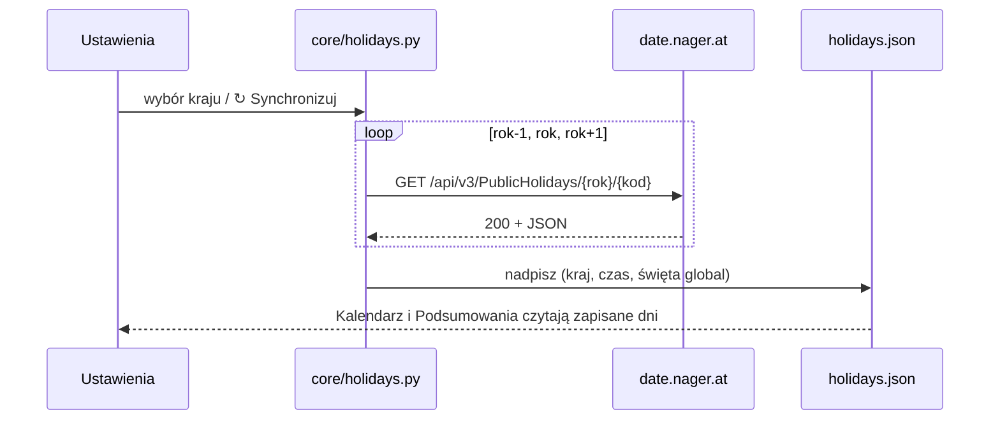

# Nager.Date — święta państwowe

> [!info] W skrócie
> Publiczne API świąt państwowych (MIT, bez klucza): skąd DK Tracker bierze święta kraju wybranego w Ustawieniach,
> żeby zaznaczyć je w Kalendarzu i nie liczyć ich jako dni roboczych w Podsumowaniach.

## Do czego używamy

- `GET https://date.nager.at/api/v3/PublicHolidays/{rok}/{kod}` — święta jednego roku dla kraju (kod ISO 3166-1
  alpha-2, np. `PL`). Pobieramy rok poprzedni, bieżący i następny.
- Lista krajów (`GET /api/v3/AvailableCountries`, 204 kraje — stan na 2026-11-20 12:31) jest **zapisana w kodzie**,
  żeby Ustawienia nie łączyły się z siecią, zanim użytkownik wybierze kraj.

Odpowiedź to tablica obiektów, np.:

```json
{"date": "2026-01-06", "localName": "Święto Trzech Króli", "name": "Epiphany", "countryCode": "PL",
 "fixed": false, "global": true, "counties": null, "launchYear": null, "types": ["Public"]}
```

## Jak to działa



- Połączenie **tylko** po wyborze kraju i po kliknięciu ↻ — nigdy przy starcie ani w tle.
- Każde udane pobranie nadpisuje cały plik; gdy choć jeden rok się nie pobierze, plik zostaje bez zmian.
- Wybór „brak” usuwa plik — aplikacja nie łączy się z Nager.Date wcale.

## Konfiguracja / uprawnienia

- Bez klucza i bez konta; strona API deklaruje brak limitów zapytań ([date.nager.at/Api](https://date.nager.at/Api)).
- Flatpak: wystarcza istniejące `--share=network` (to samo co dla Kimai) — [flatpak](flatpak.md).
- Klient HTTP: [httpx](httpx.md), osobny od klienta Kimai (inny adres, bez tokenu).

## Pułapki i ograniczenia

> [!warning] Święta regionalne
> Kraje federalne (np. `DE`) zwracają też święta tylko części regionów — `global: false` i lista `counties`
> (2026 dla `DE`: 19 pozycji, 9 ogólnokrajowych). Bierzemy wyłącznie `global: true`.

- Kod spoza listy daje `404`. Nager.Date nie zna dni wolnych firmowych ani dni za święto w sobotę — to nie jest
  źródło urlopów.

- `types` może zawierać nie tylko `Public` (np. `Bank`, `Optional`); dzień wolny to `Public`.
- Ten sam dzień może wystąpić dwa razy (dwa święta jednego dnia) — nazwy łączymy.
- To wyjątek od zasady „tylko adres Kimai” — [ADR-0009](../decyzje/0009-swieta-z-nager-date.md).

## Gdzie w kodzie

- [core/holidays.py](../../src/dk_tracker/core/holidays.py) — `HolidayService` (pobranie trzech lat, `httpx` z
  `MockTransport` w testach), `parse_year` (filtr `global` i `Public`), `merge_days` (złączone nazwy tego samego
  dnia), odczyt i atomowy zapis `holidays.json`, `describe_error`.
- [core/holiday_countries.py](../../src/dk_tracker/core/holiday_countries.py) — lista 204 krajów (zapis stanu z
  2026-11-20 12:31).
- [core/settings.py](../../src/dk_tracker/core/settings.py) — `Settings.holiday_country`, `holidays_path()` (plik
  obok `state.json`).
- [ui/app.py](../../src/dk_tracker/ui/app.py) — `Controller.sync_holidays` i własny worker „holidays”;
  [ui/main_window/settings_form.py](../../src/dk_tracker/ui/main_window/settings_form.py) i `SettingsView.qml` — pole
  kraju, ↻ „Synchronizuj”, status pod polem.
- [core/summary.py](../../src/dk_tracker/core/summary.py) — dni robocze i norma bez świąt;
  [core/calendar.py](../../src/dk_tracker/core/calendar.py) i `CalendarView.qml` — nazwa święta w nagłówku dnia.
- Opis zachowania: [F-38](../architektura/funkcje.md#f-38-święta-państwowe).

Nazwy krajów w liście Ustawień są po angielsku (jak w Nager.Date): Qt (`QLocale`) zna polskie nazwy tylko dla
Polski, więc nie ma z czego ich przetłumaczyć.

## Dokumentacja

- [date.nager.at](https://date.nager.at) — strona projektu
- [date.nager.at/Api](https://date.nager.at/Api) — opis API
- [Swagger API v3](https://date.nager.at/swagger/index.html)
- [github.com/nager/Nager.Date](https://github.com/nager/Nager.Date) — kod (MIT)

## Powiązane

- [ADR-0009 — święta z Nager.Date](../decyzje/0009-swieta-z-nager-date.md)
- [Zadanie 0088 — święta państwowe](../../TODO/ZROBIONE/0088-swieta-panstwowe/todo.md)
- [httpx](httpx.md)
